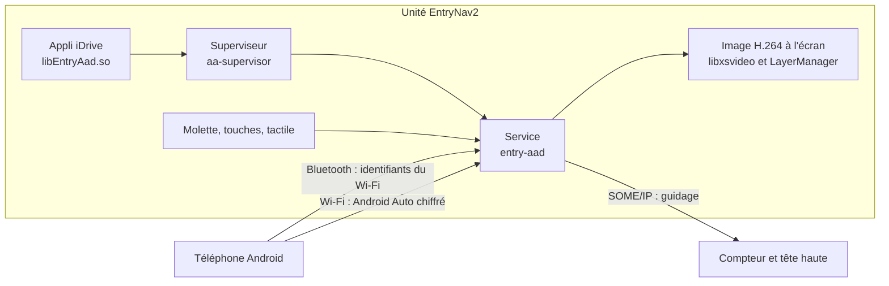

<div align="center">

# entry-aad

**Android Auto sans fil ou USB dans l'iDrive des BMW équipées d'une unité EntryNav2.**<br>
Sans boîtier, sans remplacer aucun fichier BMW.

[](https://github.com/Jiraiya43/entry-aad/actions/workflows/ci.yml)
[](https://github.com/Jiraiya43/entry-aad/releases)
[](LICENSE.md)

[English](README.md) · Français

</div>

> [!WARNING]
> Logiciel expérimental qui écrit sur le système de la voiture. Il n'a été essayé que sur **une voiture** pour
> l'instant. Lire d'abord l'[état du projet](#état-du-projet) et l'[avertissement](#licence-et-avertissement). Ni BMW
> ni Google ne sont liés à ce projet.

## Ce que ça fait

- **Android Auto sans fil** : le téléphone s'appaire en Bluetooth, puis rejoint le Wi-Fi de la voiture, celui de
  CarPlay.
- **USB facultatif** : un port configuré est prioritaire au démarrage si le téléphone y est présent ; sinon, sans fil.
  Les changements de câble prennent effet après Arrêter/Démarrer. Voir [configuration et limites USB](docs/USB.md).
- **Lancement depuis l'iDrive** : ligne *Android Auto* dans le menu Media, avec son menu (Démarrer, Arrêter, démarrage
  automatique, aide).
- **Commandes d'origine** : molette, touches, écran tactile, boutons du volant, bouton vocal vers l'Assistant.
- **Micro de la voiture** pour l'Assistant Google, **son par le Bluetooth** de la voiture.
- **GPS de la voiture** transmis au téléphone, avec retour au GPS du téléphone si besoin.
- **Guidage sur la tête haute et le compteur** : flèche, distance, rue, sortie de rond-point.
- **Cohabitation avec l'iDrive** : caméra de recul, volume, modes de conduite, jour et nuit.
- **Toujours réversible** : le Bluetooth est rendu à l'iDrive à l'arrêt, et un garde-fou désactive l'appli si l'iDrive
  plante plusieurs fois de suite après l'avoir chargée.

## État du projet

| | |
|---|---|
| Dernière version | voir les [versions publiées](https://github.com/Jiraiya43/entry-aad/releases) (avant 1.0 : des défauts restent) |
| Essayé en voiture | une BMW G20 de 2019, logiciel iDrive `202111011321` |
| Autres voitures | contrôle de compatibilité intégré ; aucune autre voiture essayée ([détails](docs/COMPATIBILITE.md)) |

Chaque changement est testé sur PC, et les programmes ARM tournent sous QEMU avec les bibliothèques de la voiture. Seul
un essai en voiture vaut preuve : le [CHANGELOG](CHANGELOG.md) dit pour chaque version si elle a été essayée en voiture
ou seulement testée sur PC.

## Il faut

- Une BMW avec une unité **EntryNav2** (appelée *EntryEVO* dans son système), un écran **1280×480** et le **Wi-Fi de
  CarPlay**. Les NBT Evo, ID7 et MGU tournent sur d'autres systèmes : ce projet ne peut pas s'y exécuter.
- Un PC avec un client SSH (Windows 10/11, Linux ou macOS) et un **câble ENET** (OBD vers Ethernet).
- Le **mot de passe root** de l'unité. Il n'est pas fourni avec ce projet.
- Un téléphone Android avec Android Auto.

## Installer

L'installation est une courte procédure manuelle par SSH, détaillée pas à pas dans
[docs/INSTALLATION.md](docs/INSTALLATION.md) :

1. Télécharger `entry-aad-<version>-armhf.tar` dans les
   [versions publiées](https://github.com/Jiraiya43/entry-aad/releases) et vérifier son empreinte SHA-256.
2. Le copier dans le `/tmp` de l'unité avec `scp`.
3. **Contrôler la voiture** : rien n'est écrit. Le chargeur de l'unité confirme chaque bibliothèque et fonction utilisée,
   et `aa-supervisor --compat` répète à blanc le démarrage d'Android Auto.
4. **Installer** : le système ne passe en écriture que le temps de copier deux dossiers (`/opt/aa` et
   `/opt/hmi/data/ro/Plugins/EntryAad`), puis l'unité redémarre.
5. Sur l'iDrive : *Media*, *Android Auto*, *Démarrer*.

Réglages et journaux sont dans `/var/local/data/AA` ([docs/MAINTENANCE.md](docs/MAINTENANCE.md)). Désinstaller retire les
deux dossiers.

## Comment ça marche



1. L'appli iDrive lance le superviseur, qui emprunte un emplacement Bluetooth et allume le Wi-Fi de la voiture.
2. Le service transmet les identifiants du Wi-Fi au téléphone par Bluetooth ; le téléphone se connecte en Wi-Fi, en TLS.
3. Le service décrit la voiture, décode la vidéo H.264 avec le décodeur matériel de l'unité et l'affiche dans sa propre
   couche du LayerManager.
4. Entrées, GPS, jour et nuit, micro et guidage circulent ensuite chacun sur son canal.

Détails : [docs/ARCHITECTURE.md](docs/ARCHITECTURE.md).

## Compiler

Il faut Linux ou WSL avec Docker, et pour la compilation ARM **une copie du système de la voiture** dans
`~/entrynav2/rootfs` (`HU_ROOTFS` pour la changer). Cette copie contient des fichiers BMW : elle ne va jamais dans git.
Sans elle, les tests sur PC tournent quand même, comme dans la CI.

```sh
make check                                              # style, contrôles de contenu, tests PC : ce que fait la CI
docker build -t entrynav2-tc:4.7 toolchain              # une fois : GCC 4.7 pour ARMv7 hard-float
bash toolchain/tc.sh make -j4 all hmiapp test-arm-all   # programmes ARM, liés aux bibliothèques de la voiture
python3 -I tests/run_qemu.py                            # tests ARM sous QEMU avec les bibliothèques de la voiture
make verify_binary verify_wireless                      # enregistre les programmes qui ont passé les tests
python3 tools/package_release.py                        # artifacts/entry-aad-<version>-armhf.tar
```

Tests et règles du projet : [CONTRIBUTING.md](CONTRIBUTING.md).

## Arborescence

```text
core/        protocole Android Auto : session, TLS, passage du Bluetooth au Wi-Fi, description de la voiture
platform/    tout ce qui est propre à l'EntryNav2 : vidéo, couches, entrées, GPS, micro, Wi-Fi, compteur
hmiapp/      appli iDrive chargée par HmiMain3D
tools/       superviseur, archive des versions et contrôles
tests/       tests PC et tests ARM sous QEMU
toolchain/   image Docker du compilateur croisé
docs/        documentation
```

## Contribuer

Signalements de bugs, rapports de compatibilité d'autres voitures et demandes de fusion sont bienvenus : voir
[CONTRIBUTING.md](CONTRIBUTING.md) et le [code de conduite](CODE_OF_CONDUCT.md). Un rapport de compatibilité (le contrôle de
l'étape 3) ne modifie rien sur la voiture et c'est ce qui aide le plus. Failles de sécurité : voir [SECURITY.md](SECURITY.md).

## Remerciements

entry-aad est parti d'un portage de [Supra-iDrive6-Android-Auto](https://github.com/Sq00ky/Supra-iDrive6-Android-Auto)
de Sq00ky, puis a été retravaillé et étendu pour l'EntryNav2. Merci à Sq00ky pour ce travail.

## Licence et avertissement

© 2026 Jiraiya43, sous [licence PolyForm Noncommercial 1.0.0](LICENSE.md) : tout usage non commercial, modification et
partage compris, à condition que la licence accompagne chaque copie. L'usage commercial n'est pas autorisé.

Le logiciel est fourni tel quel, sans aucune garantie. L'installer modifie le système de l'unité et peut concerner la
garantie de la voiture. À utiliser seulement sur sa propre voiture ou avec l'accord de son propriétaire, voiture à
l'arrêt pendant l'installation, et jamais de commande sur l'unité en roulant.

BMW et iDrive sont des marques de BMW AG ; Android et Android Auto sont des marques de Google LLC. Ce projet n'est ni
affilié à eux, ni approuvé, ni soutenu par eux.
