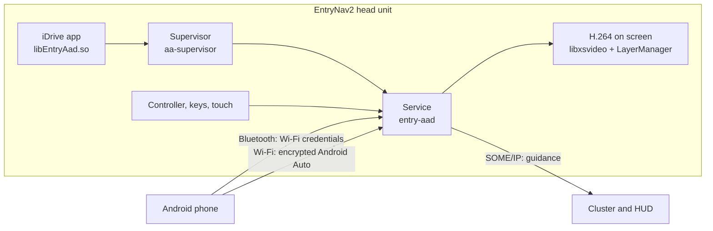

<div align="center">

# entry-aad

**Wireless Android Auto for BMW iDrive on the EntryNav2 head unit.**<br>
No dongle, no cable needed, no BMW file replaced.

[](https://github.com/Jiraiya43/entry-aad/actions/workflows/ci.yml)
[](https://github.com/Jiraiya43/entry-aad/releases)
[](LICENSE.md)

English · [Français](README.fr.md)

</div>

> [!WARNING]
> This is experimental software that writes to your car's head unit. It has been tried on **one car** so far. Read
> [Status](#status) and the [disclaimer](#licence-and-disclaimer) first. It is not affiliated with BMW or Google.

## Features

- **Wireless Android Auto.** The phone pairs over Bluetooth, then joins the car's own Wi-Fi (the one CarPlay uses).
- **A USB cable works too** (experimental, off by default), for phones without wireless Android Auto: a checkbox in
  the menu picks the cable or wireless, nothing is guessed. [Setup and limits](docs/USB.md) (in French).
- **Started from iDrive.** An *Android Auto* entry in the Media menu, with its own menu: start, stop, start
  automatically, help.
- **Original controls.** iDrive controller, hard keys, touch screen, steering wheel buttons, voice button for the
  Assistant.
- **Car microphone** for the Google Assistant, **car speakers** over Bluetooth.
- **Car GPS** sent to the phone, with a fallback to the phone's own GPS.
- **Turn-by-turn on the head-up display and cluster**: arrow, distance, street name, roundabout exit.
- **Lives alongside iDrive**: reversing camera, volume overlay, driving modes, day and night.
- **Always reversible.** Bluetooth goes back to iDrive when Android Auto stops, and a guard switches the app off if
  iDrive crashes several times in a row after loading it.

## Status

| | |
|---|---|
| Latest release | see [Releases](https://github.com/Jiraiya43/entry-aad/releases) (pre-1.0: expect rough edges) |
| Tried in a car | one 2019 BMW G20, iDrive software `202111011321` |
| Other cars | a compatibility check is built in; no other car has been tried yet ([details](docs/COMPATIBILITE.md)) |

Every change is tested on a PC, and the ARM programs run under QEMU against the car's own libraries. Only a car test
counts as proof: [CHANGELOG.md](CHANGELOG.md) says for each version whether it was tried in a car or only tested on a PC.

## Requirements

- A BMW with an **EntryNav2** head unit (called *EntryEVO* inside its system), a **1280×480** screen and the
  **CarPlay Wi-Fi**. NBT Evo, ID7 and MGU units run other systems: this project cannot run on them.
- A PC with an SSH client (Windows 10/11, Linux or macOS) and an **ENET cable** (OBD to Ethernet).
- The head unit's **root password**. It is not provided with this project.
- An Android phone with Android Auto.

## Installing

Installation is a short manual procedure over SSH, described step by step in
[docs/INSTALLATION.md](docs/INSTALLATION.md) (in French; the commands speak for themselves):

1. Download `entry-aad-<version>-armhf.tar` from [Releases](https://github.com/Jiraiya43/entry-aad/releases) and check
   its SHA-256.
2. Copy it to the head unit's `/tmp` with `scp`.
3. **Check the car**: nothing is written. The unit's own loader confirms every library and function the programs need,
   and `aa-supervisor --compat` rehearses the startup of Android Auto.
4. **Install**: the system is remounted read-write only while two folders are copied (`/opt/aa` and
   `/opt/hmi/data/ro/Plugins/EntryAad`), then the unit restarts.
5. On iDrive: *Media*, *Android Auto*, *Démarrer*.

Settings and logs live in `/var/local/data/AA` ([docs/MAINTENANCE.md](docs/MAINTENANCE.md)). Uninstalling removes the two
folders.

## How it works



1. The iDrive app starts the supervisor, which borrows a Bluetooth slot and switches the car's Wi-Fi on.
2. The service sends the Wi-Fi credentials to the phone over Bluetooth; the phone connects back over Wi-Fi with TLS.
3. The service describes the car, decodes the phone's H.264 video with the unit's hardware decoder and shows it in its
   own LayerManager layer.
4. Input, GPS, day and night, microphone and guidance each travel on their own channel.

Details in [docs/ARCHITECTURE.md](docs/ARCHITECTURE.md).

## Building from source

You need Linux or WSL with Docker, and for the ARM build **a copy of the car's system** in `~/entrynav2/rootfs`
(`HU_ROOTFS` to change it). That copy holds BMW files: it never goes into git. Without it, the PC tests still run, as
in CI.

```sh
make check                                              # style, content checks, PC tests: what CI runs
docker build -t entrynav2-tc:4.7 toolchain              # once: GCC 4.7 for ARMv7 hard-float
bash toolchain/tc.sh make -j4 all hmiapp test-arm-all   # ARM programs, linked against the car's libraries
python3 -I tests/run_qemu.py                            # ARM tests under QEMU with the car's libraries
make verify_binary verify_wireless                      # record the programs that passed
python3 tools/package_release.py                        # artifacts/entry-aad-<version>-armhf.tar
```

See [CONTRIBUTING.md](CONTRIBUTING.md) for the full test list and the project's rules.

## Repository layout

```text
core/        Android Auto protocol: session, TLS, Bluetooth-to-Wi-Fi handshake, car description
platform/    everything specific to EntryNav2: video, layers, input, GPS, microphone, Wi-Fi, cluster
hmiapp/      the iDrive app loaded by HmiMain3D
tools/       supervisor, release packaging and checks
tests/       PC tests and ARM tests under QEMU
toolchain/   Docker image of the cross compiler
docs/        documentation (French)
```

## Contributing

Bug reports, compatibility reports from other cars and pull requests are welcome: see
[CONTRIBUTING.md](CONTRIBUTING.md) and the [code of conduct](CODE_OF_CONDUCT.md). A compatibility report (the check of
step 3) changes nothing on the car and helps the most. Security issues: see [SECURITY.md](SECURITY.md).

## Credits

entry-aad started as a port of [Supra-iDrive6-Android-Auto](https://github.com/Sq00ky/Supra-iDrive6-Android-Auto) by
Sq00ky, then was reworked and extended for the EntryNav2. Thanks to Sq00ky for that work.

## Licence and disclaimer

© 2026 Jiraiya43, under the [PolyForm Noncommercial License 1.0.0](LICENSE.md): any noncommercial use, including
modifying and sharing, as long as the licence goes with every copy. Commercial use is not allowed.

The software comes as is, without any warranty. Installing it modifies the head unit's system and may affect your
warranty. Use it only on a car you own or with its owner's consent, with the car parked during installation, and
never operate the head unit's shell while driving.

BMW and iDrive are trademarks of BMW AG; Android and Android Auto are trademarks of Google LLC. This project is not
affiliated with, endorsed or sponsored by either.
